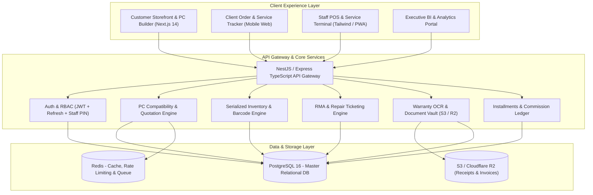
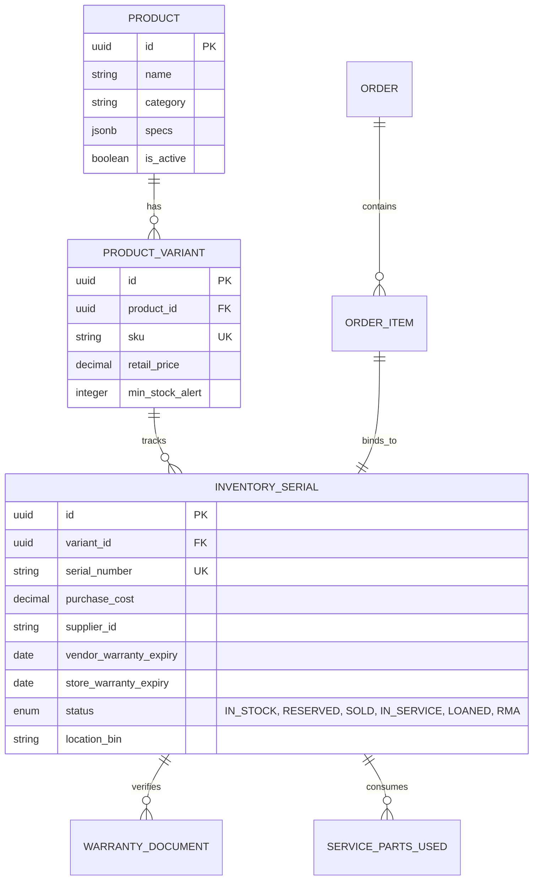
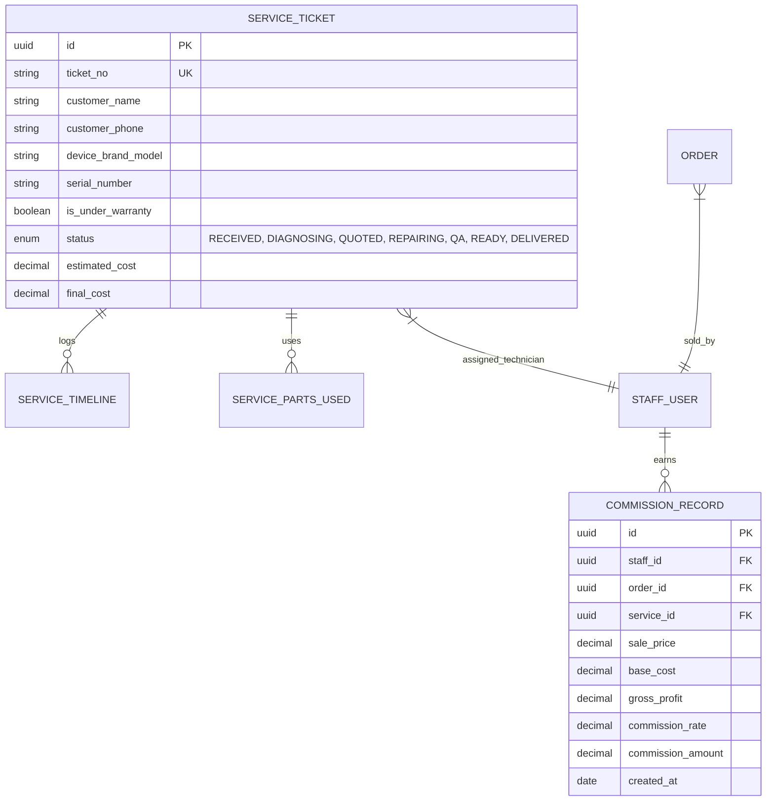

# Computer Shop ERP & E-Commerce Platform — Implementation Plan

A modern, high-performance omnichannel ERP and Customer Experience platform tailored specifically for computer hardware retailers, custom PC builders, and authorized repair centers.

---

## 1. Goal Description

Computer hardware retail and repair operations face unique operational challenges:
- High unit-cost items requiring **strict serial number tracking** from supplier intake to customer delivery.
- Complex PC building requiring **dynamic hardware compatibility checks** (socket matching, clearance, thermal budget, PSU headroom) and instant **quotation generation**.
- Warranty verification friction requiring **digital document storage** (physical receipts, supplier slips) searchable by serial number.
- High-ticket installment/hire-purchase sales requiring **loan payment schedules and KYC tracking**.
- Two-way **service and RMA repair tracking** with staff accountability, parts allocation, and customer transparency.
- Staff sales commissions calculated on **real gross margin** (Selling Price minus Serialized Unit Purchase Cost) rather than top-line revenue.

This project delivers a unified architecture bridging the customer-facing storefront/portal with internal back-office ERP workflows.

---

## 2. User Review Required

> [!IMPORTANT]
> **Key Decisions to Confirm with Stakeholders:**
> 1. **Document Storage Provider**: Should warranty scans/PDFs be stored on **AWS S3 / Cloudflare R2** with pre-signed URLs, or synchronized directly to **Google Drive API**? (Recommended: Cloudflare R2 / AWS S3 for deterministic latency and strict access control, with optional Google Drive backup sync).
> 2. **Staff Commission Model**: Is commission calculated as a flat percentage of gross profit per category, or tiered based on monthly quota achievement?
> 3. **Customer Notifications**: Should customer tracking updates (order placed, quote ready, repair milestone) trigger via **WhatsApp Business Cloud API**, **Twilio SMS**, or both?

---

## 3. System Architecture & Tech Stack

---

## 4. Domain Models & Database Schemas

### 4.1 Master Catalog & Serial Inventory

### 4.2 Repair Service Lifecycle & Staff Commission

---

## 5. Module Breakdown & Development Tasks

### Module 1: Customer Storefront & Dynamic PC Builder Wizard
- **Task 1.1**: Responsive e-commerce catalog with multi-facet filters (Socket type, RAM generation, GPU length, TDP, Form factor).
- **Task 1.2**: 8-Step PC Builder State Machine with live compatibility validator:
  - CPU $\leftrightarrow$ Motherboard socket check (`LGA1700`, `AM5`, `AM4`).
  - Motherboard $\leftrightarrow$ RAM type check (`DDR4` vs `DDR5`).
  - Total Estimated Wattage calculation $\times 1.25$ PSU safety overhead recommendation.
  - Case Dimensions $\leftrightarrow$ GPU length and CPU Cooler height clearance.
- **Task 1.3**: Instant PDF Quotation Generator with QR Code, 7-day price lock timestamp, and 1-click WhatsApp share button.
- **Task 1.4**: Promotional bundle engine (e.g. "Buy CPU + Motherboard, get 10% off RAM").

### Module 2: Itemized Serial Number Inventory Engine
- **Task 2.1**: Master SKU vs Itemized Serial Number mapping.
- **Task 2.2**: Barcode/QR Code generator and mobile camera scanner integration for high-speed stock intake and checkout.
- **Task 2.3**: Real-time stock reservation lock during customer checkout / quotation creation with 30-minute expiration.
- **Task 2.4**: Supplier purchase order (PO) intake workflow with batch serial registration (CSV upload / bulk scan).

### Module 3: Digital Warranty Vault & OCR Document Engine
- **Task 3.1**: Secure S3/Cloudflare R2 document storage with customer privacy encryption.
- **Task 3.2**: Serial Number indexing pipeline: Upload receipt image/PDF $\rightarrow$ Extract Serial/Date/Invoice $\rightarrow$ Link to `INVENTORY_SERIAL`.
- **Task 3.3**: Customer and Staff Instant Serial Search UI: Preview document in modal, Print official warranty claim sheet, or share via WhatsApp/Email.
- **Task 3.4**: Warranty status calculator (calculates days remaining for both Store Warranty and Manufacturer Direct Warranty).

### Module 4: Service & Repair Management System
- **Task 4.1**: Service Ticket Intake: Auto-checks serial number against internal database to detect if device was purchased in-store and warranty validity.
- **Task 4.2**: Visual Repair Kanban Board for workshop technicians (Drag-and-Drop: Intake $\rightarrow$ Diagnostic $\rightarrow$ Waiting Customer Approval $\rightarrow$ Parts Sourcing $\rightarrow$ Bench Repair $\rightarrow$ Bench Test/QA $\rightarrow$ Ready for Pickup).
- **Task 4.3**: Parts Allocation: Reserve and deduct replacement parts directly from inventory using their serial numbers.
- **Task 4.4**: Customer Live Tracking URL (`/track/[ticket_no]?token=...`) with milestone timeline, technician notes, and digital estimate approval button.

### Module 5: Staff Accounts, POS & Margin-Based Commission Engine
- **Task 5.1**: Staff Role-Based Access Control (Admin, Sales Cashier, Workshop Tech, Stock Clerk).
- **Task 5.2**: Daily Staff Journal: Cash register opening/closing, items sold count, service repairs logged, refunds processed.
- **Task 5.3**: Accurate Gross-Profit Commission Calculation:
  $$\text{Gross Profit} = \text{Selling Price} - \text{Specific Serial Unit Cost}$$
  $$\text{Commission} = \text{Gross Profit} \times \text{Commission Rate \%}$$
- **Task 5.4**: Owner/Manager Performance Scoreboard: Leaderboard of sales, average repair turnaround time, and technician repair success rate.

### Module 6: Loan / Device Installment Management (Hire-Purchase)
- **Task 6.1**: Installment Contract Builder: Down payment, repayment term (3, 6, 12 months), interest/markup rate, and automated monthly installment schedule generator.
- **Task 6.2**: Customer KYC Document Locker (National ID, address verification, guarantor agreement).
- **Task 6.3**: Payment collection ledger: record partial/full installment payments, recalculate remaining balance, auto-print installment receipt.
- **Task 6.4**: Overdue alert system: automated SMS/WhatsApp payment reminder 3 days prior, on due date, and overdue escalation tags.

---

## 6. Core REST API Endpoint Specification

| Module | Method | Endpoint | Description | Auth Level |
|---|---|---|---|---|
| **Catalog** | `GET` | `/api/v1/products` | Filter catalog with specs & real-time stock | Public |
| **PC Builder** | `POST` | `/api/v1/pc-builder/validate` | Verify socket, RAM, wattage & clearance compatibility | Public |
| **Quotation** | `POST` | `/api/v1/quotations` | Generate formal PDF quotation with locked pricing | Public / Client |
| **Inventory** | `GET` | `/api/v1/inventory/serials/:serialNo` | Lookup serial lifecycle, costs, warranty & status | Staff |
| **Inventory** | `POST` | `/api/v1/inventory/serials/batch-intake` | Bulk intake scanned serial numbers with purchase costs | Staff / Admin |
| **Warranty** | `POST` | `/api/v1/warranty/upload` | Upload PDF/image warranty doc and bind to serial | Staff |
| **Warranty** | `GET` | `/api/v1/warranty/search?serial=...` | Retrieve digital warranty doc & print/share links | Public / Staff |
| **Service** | `POST` | `/api/v1/service/tickets` | Create service order, verify warranty & assign tech | Staff |
| **Service** | `PATCH` | `/api/v1/service/tickets/:id/stage` | Move repair milestone & append technician log | Technician |
| **Service** | `GET` | `/api/v1/service/track/:trackingToken` | Customer public live status & timeline tracker | Public |
| **Staff POS** | `POST` | `/api/v1/pos/checkout` | Process sale, bind serial numbers, trigger commission | Cashier |
| **Staff BI** | `GET` | `/api/v1/staff/commissions/daily` | Calculate daily gross margins and commission report | Staff / Admin |
| **Loan** | `POST` | `/api/v1/installments/contracts` | Create device installment plan & repayment schedule | Admin / Staff |
| **Loan** | `POST` | `/api/v1/installments/:id/payments` | Record installment payment and update balance | Cashier |

---

## 7. Implementation Roadmap & Phased Execution

- **Phase 1 (Week 1-2)**: Core Data Layer, Serialized Inventory Engine & Staff Auth RBAC.
- **Phase 2 (Week 3-4)**: PC Compatibility Engine, E-Commerce Storefront & PDF Quotation Generator.
- **Phase 3 (Week 5-6)**: Service/Repair Workshop Kanban & Customer Live Tracking Portal.
- **Phase 4 (Week 7-8)**: Digital Warranty Vault, Document OCR & Serial Search Engine.
- **Phase 5 (Week 9-10)**: Staff POS, Margin-Based Commission Engine & Cashier Journal.
- **Phase 6 (Week 11-12)**: Device Installment / Loan Management, SMS Alerts & Executive BI Dashboard.

---

## 8. Verification & Testing Plan

### Automated Testing
- **Unit Tests**: PC compatibility rules engine (100% matrix test for CPU/Motherboard/RAM/Cooler/GPU/PSU).
- **Integration Tests**: Serial number lifecycle transition validation (prevent double-selling or assigning in-service serials).
- **Commission Accuracy**: Automated mathematical verification of Gross Profit and Commission values across varied discounts.

### Manual Stakeholder Verification
1. Walkthrough of the 3D Interactive Pipeline artifact with the shop owner.
2. Simulated barcode scan intake of 20 serial numbers $\rightarrow$ instant catalog reflection.
3. End-to-end Customer PC Build $\rightarrow$ Quotation download $\rightarrow$ POS conversion with Serial selection.
4. Service order intake for an expired warranty item $\rightarrow$ Technician diagnosis $\rightarrow$ Customer approval $\rightarrow$ Pickup notification.
